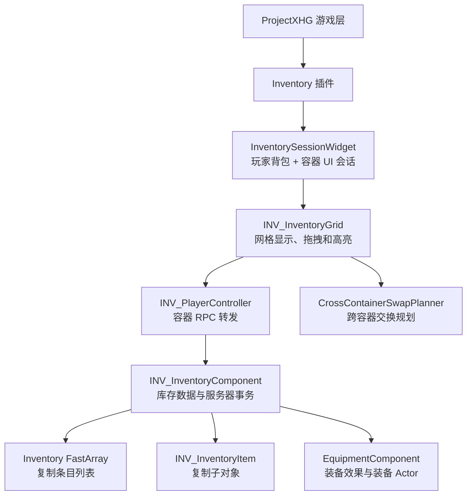
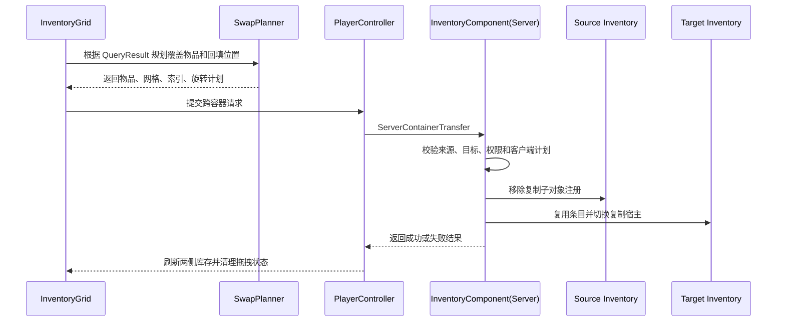

# ProjectXHG / InventorySystem


ProjectXHG 是一个基于 Unreal Engine 5.7 的游戏项目，包含角色、战斗、平台移动和库存系统模块。

当前 1.0 版本重点完成了以 Session 为 UI 纽带的玩家背包与容器交互，并支持专用服务器下的跨容器事务、装备换装、物品旋转、多物品交换和失败回滚。

## 项目简介

InventorySystem 主要解决以下问题：

- 玩家背包和容器 UI 的统一管理；
- 玩家背包、容器和装备槽之间的物品转移；
- 多格物品、旋转物品和混合分类物品的空间规划；
- 服务器权威下的跨容器事务与回滚；
- 复制子对象在不同库存宿主之间的安全切换；
- 装备效果、装备 Actor 和 UI 状态同步。

## 模块架构



### 核心模块

| 模块 | 职责 |
| --- | --- |
| `UINV_InventorySessionWidget` | 管理玩家背包和容器 UI，会话是两侧 UI 的唯一连接纽带 |
| `AINV_PlayerController` | 接收客户端容器请求并转发到服务器 |
| `UINV_InventoryComponent` | 管理库存条目、服务器校验、事务提交和回滚 |
| `UINV_InventoryGrid` | 绘制网格、计算落点、处理拖拽和高亮 |
| `FINV_CrossContainerSwapPlanner` | 生成跨容器多物品回填计划 |
| `UINV_InventoryItem` | 作为复制子对象保存物品位置、朝向、数量和装备状态 |
| `UINV_EquipmentComponent` | 应用装备效果、撤销效果并管理装备 Actor |

## 跨容器交互流程



跨容器整件物品会复用原 `UINV_InventoryItem`，不会创建新的物品副本。部分堆叠拆分仍会创建新的条目，这是数量拆分所必需的行为。

## 目录结构

```text
ProjectXHG/
├─ Config/                         Unreal 项目配置
├─ Content/                        蓝图、材质、网格和 UI 资产
├─ Plugins/Inventory/              库存插件
│  └─ Source/Inventory/
│     ├─ Public/                   公开接口和数据结构
│     ├─ Private/                  组件、UI、RPC 和事务实现
│     └─ Private/Tests/            自动化测试
├─ Source/ProjectXHG/              游戏主模块
├─ WorkSpace/                      开发记录、验收文档和版本清单
├─ ProjectXHG.uproject             Unreal 项目文件
└─ .gitignore                      构建产物和临时目录忽略规则
```

## 构建

使用 Unreal Engine 5.7 和 Visual Studio 2022：

```powershell
& 'D:\UE\UE_5.7\Engine\Build\BatchFiles\Build.bat' `
  ProjectXHGEditor Win64 Development `
  -Project='C:\Users\Administrator\Desktop\ProjectXHG\ProjectXHG.uproject' `
  -NoHotReloadFromIDE
```

## 自动化测试

运行全部 Inventory 测试：

```powershell
& 'D:\UE\UE_5.7\Engine\Binaries\Win64\UnrealEditor-Cmd.exe' `
  'C:\Users\Administrator\Desktop\ProjectXHG\ProjectXHG.uproject' `
  -unattended -nop4 -NullRHI -nosplash -DDC-ForceMemoryCache `
  -ExecCmds='Automation RunTests Inventory;Quit'
```

当前已覆盖：

- 库存权威快照；
- 容器交互；
- 旋转和边缘落点；
- 丢弃生成失败保护；
- 装备 Actor 与代理状态；
- 服务端参数校验；
- 堆叠拆分和旋转；
- 跨容器原子转移和交换计划。

## 版本状态

当前代码已整理为 **Inventory 1.0 Candidate**，主要功能已完成冻结。后续改动应优先处理阻塞性问题、回归缺陷和版本发布整理。

详细记录见：

- [`WorkSpace/Experience/ProjectXHG_Inventory_1.0-Candidate.md`](WorkSpace/Experience/ProjectXHG_Inventory_1.0-Candidate.md)
- [`WorkSpace/Experience/ProjectXHG_Inventory_1.0收尾清单.md`](WorkSpace/Experience/ProjectXHG_Inventory_1.0收尾清单.md)
- [`WorkSpace/Experience/跨容器库存迭代归档.md`](WorkSpace/Experience/跨容器库存迭代归档.md)
